# pbDBbackup

**Respaldo lógico de esquemas Oracle a scripts SQL restaurables**, con visor web sin servidor y copia automática en Cloudflare R2.

Pensado para Oracle Autonomous Database (incluido el free tier de OCI), donde los respaldos administrados son limitados y Data Pump no deja nada legible. pbDBbackup lee el esquema completo (estructura, código y datos) y genera scripts `.sql` en texto plano, ordenados para restaurarse sin errores con SQLcl o SQL\*Plus en un esquema vacío, ya sea el mismo u otro.

<p align="center">
  
</p>

> Todas las imágenes y videos de este repositorio usan un esquema de demostración (`TIENDA_DEMO`) con **datos ficticios**.

---

## Contenido

- [Arquitectura](#arquitectura)
- [Simulación del flujo](#simulación-del-flujo)
- [Qué respalda](#qué-respalda)
- [Qué genera](#qué-genera)
- [Parámetros](#parámetros)
- [Visor web](#visor-web)
- [Restaurar](#restaurar)
- [Copia en Cloudflare R2 y ejecución en varios nodos](#copia-en-cloudflare-r2-y-ejecución-en-varios-nodos)

---

## Arquitectura

<p align="center">
  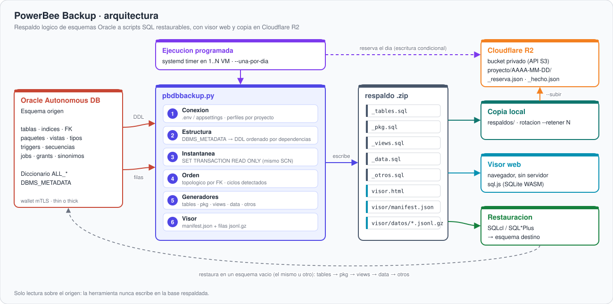
</p>

pbDBbackup es una CLI en Python de **un solo archivo**. Solo depende de `python-oracledb` y `python-dotenv` (más `boto3` si se usa la copia en R2). Se conecta al esquema de origen con el wallet mTLS de Autonomous DB, en modo *thin* o *thick* (Instant Client), y recorre seis etapas:

| # | Etapa | Qué hace |
|---|---|---|
| 1 | **Conexión** | Resuelve credenciales desde un `.env`, un `appsettings*.json` de .NET o argumentos. Los perfiles por proyecto guardan solo rutas y **nombres** de variables, nunca claves. |
| 2 | **Estructura** | Extrae el DDL con `DBMS_METADATA` (sin storage, tablespace ni prefijo de owner) y lo ordena por dependencias (`ALL_DEPENDENCIES`): lo referenciado va primero y la especificación antes que el body. |
| 3 | **Instantánea** | Abre `SET TRANSACTION READ ONLY`: todas las tablas se leen en el mismo SCN, así que el respaldo es consistente aunque la aplicación siga escribiendo. |
| 4 | **Orden** | Ordena las tablas topológicamente según sus FK (padres antes que hijas) y detecta autorreferencias y ciclos para desactivar solo esas FK durante la carga. |
| 5 | **Generadores** | Escribe un script por categoría (`tables`, `pkg`, `views`, `data`, `otros`), directo a un `.zip` si se pide, sin dejar texto plano en disco. |
| 6 | **Visor** | En la misma pasada de datos guarda las filas en JSON Lines comprimido y un `manifest.json` con el árbol de objetos para el visor web. |

El resultado va a una **copia local** con rotación, opcionalmente a un **bucket privado de Cloudflare R2**, y puede abrirse en el **visor web** o restaurarse con **SQLcl / SQL\*Plus**.

**Principios de diseño**

- **Solo lectura sobre el origen.** La herramienta nunca escribe en la base respaldada. La estructura se lee con `SELECT` al diccionario (`ALL_*`, `DBMS_METADATA`) y los datos, dentro de una transacción `READ ONLY`.
- **El diccionario es la fuente de verdad.** Tipos, PK, FK, identidades, triggers y secuencias se leen siempre de la base, no de archivos del proyecto.
- **Restaurable en cualquier máquina.** Fechas y números se exportan con formatos explícitos, así que el resultado no depende del NLS. Las líneas miden menos de ~1500 caracteres (SQL\*Plus) y los literales no pasan de 4000 bytes.
- **Nunca un respaldo a medias con aspecto de completo.** Se escribe como `*.parcial` y se renombra al terminar.
- **Distribuible.** Varias VM pueden respaldar las mismas bases: una reserva atómica en R2 decide quién sube cada día.

---

## Simulación del flujo

Ejecución programada de un respaldo completo con visor, subida a R2 y restauración. El diagrama resalta la pieza que trabaja en cada momento y la consola muestra los mensajes reales de la herramienta.

<p align="center">
  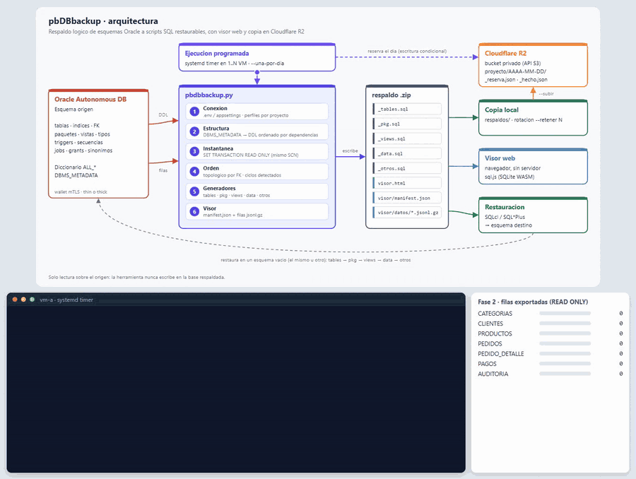
</p>

▶ [Ver en MP4 (mejor calidad)](assets/video/sim-flujo.mp4)

Mientras trabaja, la consola muestra una línea por tarea:

```
------------------------------------------------------------
  Proyecto : demo
  Conexion : TIENDA_DEMO@demodb_tp  (modo thin)
  Esquema  : TIENDA_DEMO
  Que      : tables, pkg, views, data, otros
  Nodo     : vm-a
------------------------------------------------------------
  [OK] Reservado pbdb/demo/2026-11-21/ para vm-a: se procede a respaldar
  leyendo estructura      .............................. ok
  comprimiendo tables     .............................. ok  38 objeto(s)
  comprimiendo pkg        .............................. ok  4 objeto(s)
  comprimiendo views      .............................. ok  2 objeto(s)
  comprimiendo otros      .............................. ok  3 objeto(s)
  comprimiendo data       .............................. ok  7 tabla(s), 27,333 fila(s)
  preparando visor        .............................. ok  7 tabla(s), 12 dependencia(s)

  [OK] comprimido -> respaldos/demo_tienda_demo_20261121_030512.zip

  Subiendo a R2 (bucket pbdb-respaldos, carpeta pbdb/demo/2026-11-21/):
    [OK] pbdb/demo/2026-11-21/demo_tienda_demo_20261121_030512.zip  (1,054,643 bytes)
    [OK] pbdb/demo/2026-11-21/_hecho.json
```

---

## Qué respalda

`--quecosa` elige las categorías. Cada una genera su propio script:

| Valor | Archivo | Contenido |
|---|---|---|
| `tables` | `*_tables.sql` | secuencias → tablas (con PK/UNIQUE/CHECK, padres primero) → índices → comentarios → claves foráneas → triggers |
| `pkg` | `*_pkg.sql` | tipos, funciones, procedimientos y paquetes (spec y body) ordenados por dependencias, con recompilación final |
| `views` | `*_views.sql` | vistas ordenadas por dependencia entre ellas, con sus comentarios |
| `data` | `*_data.sql` | los `INSERT` de todas las tablas (ver [Qué genera](#qué-genera)) |
| `otros` | `*_otros.sql` | sinónimos, vistas materializadas, triggers de vista/esquema, grants otorgados y jobs de `DBMS_SCHEDULER`. Como comentario van los DB links (no se respaldan porque llevan credenciales) y los privilegios del usuario |

`todo` equivale a las cinco. El DDL sale de `DBMS_METADATA` sin storage, tablespace ni prefijo de owner. Si un objeto no se puede extraer, se avisa con `[!]` y queda marcado en el archivo sin abortar el respaldo.

**Orden de restauración:** `tables → pkg → views → data → otros`.

Si no se indica una lista de tablas, se respaldan **todas** las del owner. Se excluyen las temporales, las externas, las vistas materializadas y las tablas de sistema (`BIN$`, `DR$`, `MLOG$_`…). Si la lista declarada y la base no coinciden, la herramienta avisa qué tablas faltan y cuáles quedan fuera.

---

## Qué genera

El script de datos (`*_data.sql`, UTF-8) tiene fases explícitas:

1. **Cabecera:** proyecto, esquema, fecha, origen de la lista de tablas, `SET DEFINE OFF` y `WHENEVER SQLERROR EXIT ... ROLLBACK`.
2. **Fase 0** (opcional, `--con-delete`): `DELETE` en orden inverso de FK.
3. **Fase 1:** desactiva los triggers activos y las FK problemáticas, y pasa las identidades `GENERATED ALWAYS` a `BY DEFAULT` (si no, Oracle rechaza el id original con ORA-32795).
4. **Fase 2:** los `INSERT` tabla por tabla, padres antes que hijas, con las filas ordenadas por PK y un `COMMIT` cada 1000 filas.
5. **Fase 3:** devuelve cada identidad a su modo original con `START WITH LIMIT VALUE`, reposiciona las secuencias, reactiva las FK y los triggers.
6. **Resumen** de filas por tabla.

```sql
-- Fase 1: preparar carga
ALTER TRIGGER "TRG_PEDIDOS_AUD" DISABLE;
ALTER TABLE "PEDIDOS" MODIFY "ID_PEDIDO" GENERATED BY DEFAULT AS IDENTITY;

-- Fase 2: datos (padres primero)
INSERT INTO "CATEGORIAS" ("ID_CATEGORIA", "NOMBRE", "DESCRIPCION", "CREADO_EN") VALUES (
1, 'Hogar', 'Productos de hogar', TO_DATE('2025-01-01 00:00:00', 'YYYY-MM-DD HH24:MI:SS'));
...
-- Fase 3: restablecer
ALTER TABLE "PEDIDOS" MODIFY "ID_PEDIDO" GENERATED BY DEFAULT ON NULL AS IDENTITY (START WITH LIMIT VALUE);
ALTER SEQUENCE "SEQ_FACTURA" RESTART START WITH 5021;
ALTER TRIGGER "TRG_PEDIDOS_AUD" ENABLE;
COMMIT;
```

**Detalles de fidelidad**

- Fechas, timestamps (con y sin zona) e intervalos usan `TO_CHAR` con máscara fija, y los números, `NLS_NUMERIC_CHARACTERS='.,'`.
- En los textos se duplican las comillas, los saltos de línea y caracteres de control van como `CHR(n)` y los literales se parten en trozos de 500 caracteres.
- Los CLOB, BLOB y XMLTYPE grandes se cargan con un bloque PL/SQL (`DBMS_LOB` sobre un LOB temporal) en vez de un literal, que está limitado a 4000 bytes.
- Las columnas `JSON` o `IS JSON` se exportan como texto JSON.
- Se omiten las columnas virtuales y ocultas. Los tipos sin representación literal (`BFILE`, `ROWID`, tipos objeto, `SDO_GEOMETRY`) se avisan y se omiten.

---

## Parámetros

| Parámetro | Qué hace |
|---|---|
| `--proyecto NOMBRE` | Usa un perfil del archivo de configuración (rutas y nombres de variables, sin claves) |
| `--listar-proyectos` | Muestra los perfiles disponibles |
| `--env RUTA` | `.env` del proyecto, o `appsettings*.json` de .NET (se detecta por la extensión) |
| `--db-user`, `--db-password` | Usuario y clave explícitos. Si falta la clave y hay consola, se pide sin eco |
| `--user-var`, `--password-var` | Leer otra variable del `.env` para el usuario o la clave |
| `--dsn`, `--wallet-dir`, `--wallet-password`, `--lib-dir` | Conexión explícita |
| `--modo auto\|thin\|thick` | `auto` usa thick si hay Instant Client y, si no, thin |
| `--pool NOMBRE` | Pool de `appsettings` .NET del que se toman las credenciales |
| `--owner ESQUEMA` | Respaldar otro esquema (requiere `SELECT` sobre sus tablas) |
| `--json RUTA` | Lista de tablas desde un JSON |
| `--sql-dir RUTA` | Lista de tablas desde una carpeta de DDL (`CREATE TABLE` en `*.sql`) |
| `--tablas A,B` / `--excluir A,B` | Lista explícita de tablas / tablas a excluir |
| `--quecosa X,Y` | `todo`, `tables`, `pkg`, `views`, `data`, `otros` (por defecto `todo`) |
| `--solo-listar` | No escribe nada: lista los objetos por categoría y las filas por tabla |
| `-o, --salida ARCHIVO` | Archivo de salida (`.gz` comprime) |
| `--comprimir` | Un único `.zip` con todos los scripts, escritos directo al zip |
| `--visor` | Agrega el visor web y sus datos al zip (implica `--comprimir`) |
| `--con-delete` | El script vacía las tablas (hijas primero) antes de insertar |
| `--deshabilitar-fk` | Desactiva todas las FK durante la carga (por defecto solo autorreferencias y ciclos) |
| `--sin-secuencias` | No reposiciona las secuencias |
| `--subir` | Después de generar, sube el respaldo a Cloudflare R2 y verifica el tamaño remoto |
| `--una-por-dia` | Para ejecución programada: como máximo un respaldo por proyecto y día, coordinado entre nodos |
| `--si-en-r2 local\|omitir` | Si otro nodo ya reservó o subió el día: extraer igual y dejar solo la copia local, o no hacer nada |
| `--retener N` | Conserva solo las N copias locales más recientes del proyecto |

Variables que se reconocen solas en un `.env`: `DB_USER`/`ORACLE_USER`, `DB_PASSWORD`/`ORACLE_PASSWORD`, `DB_CONNECT_STRING`/`ORACLE_DSN`, `DB_WALLET_DIR`/`ORACLE_CONFIG_DIR`/`TNS_ADMIN`, `DB_WALLET_PASSWORD` y `ORACLE_LIB_DIR`.

---

## Visor web

Un navegador de respaldos al estilo SQL Developer o TOAD, pero en el navegador y **sin servidor**. Es un único `visor.html` (CSS y JS inline, sin build) que viaja dentro del zip: se abre con doble clic y se le arrastra el respaldo. Todo corre localmente y no se sube nada.

<p align="center">
  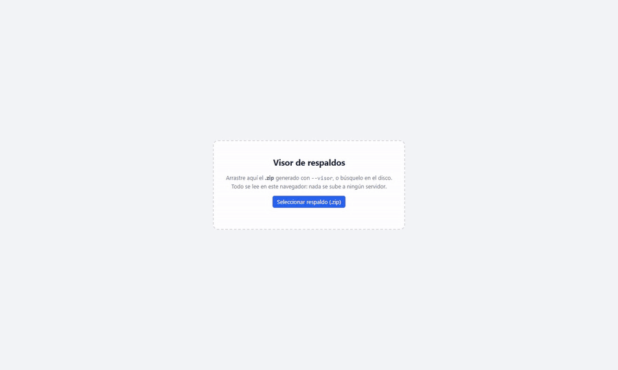
</p>

▶ [Ver en MP4](assets/video/visor-recorrido.mp4)

| | |
|---|---|
| 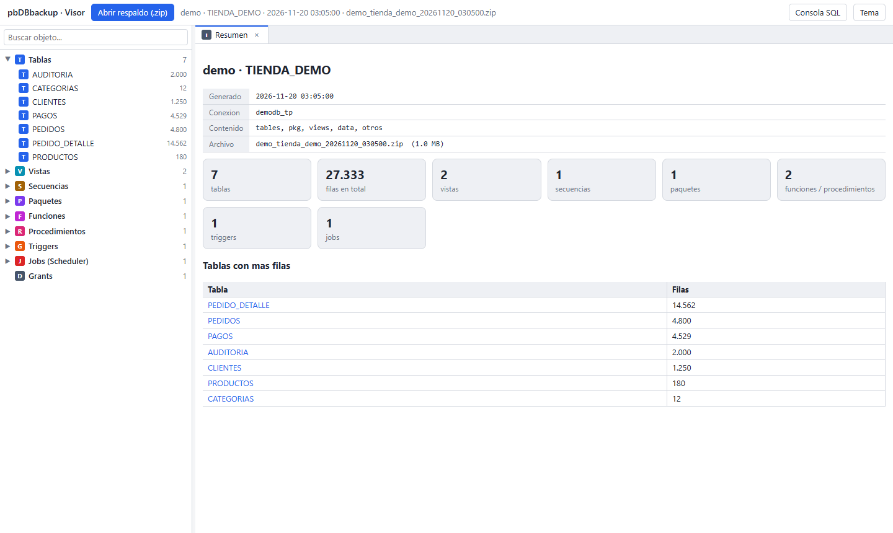 | 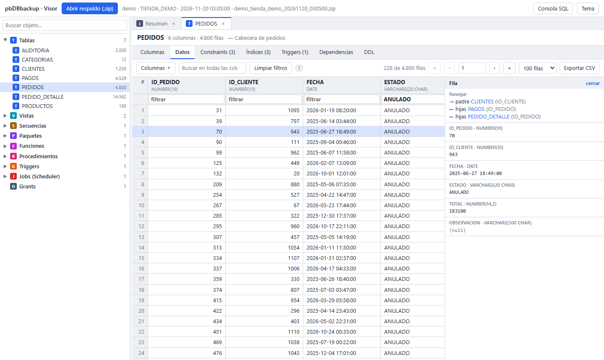 |
| **Resumen**: objetos, filas y tablas más grandes | **Datos**: filtros por columna, detalle de fila y navegación por FK |
| 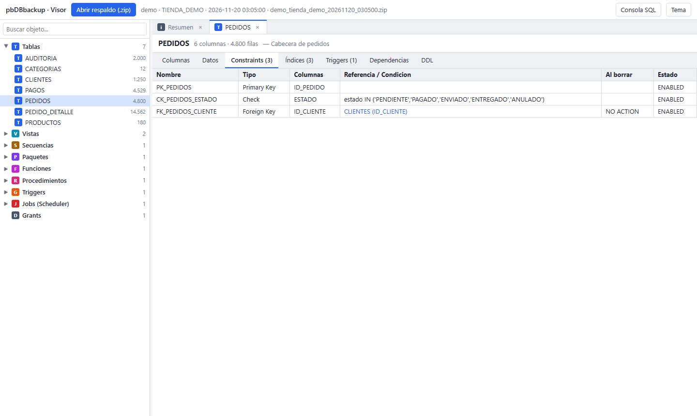 | 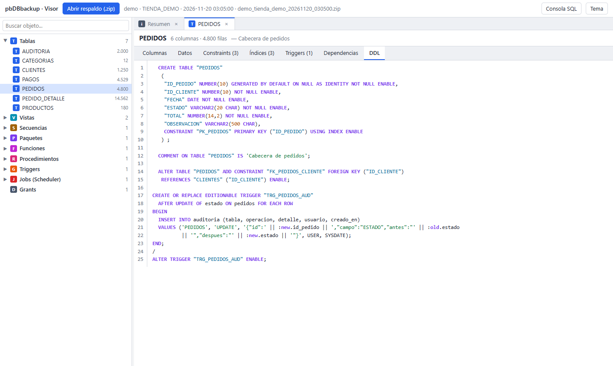 |
| **Constraints**: PK, UK, CHECK y FK con su referencia | **DDL** de cada tabla con índices, FK y triggers |
| 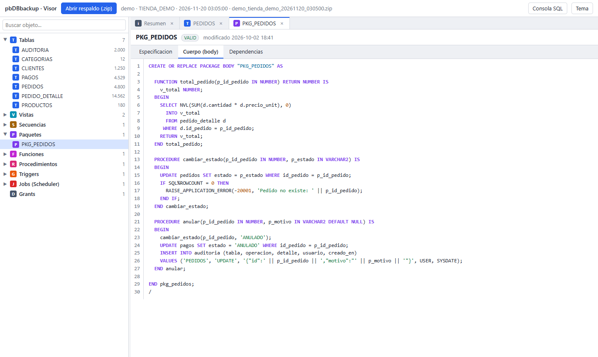 | 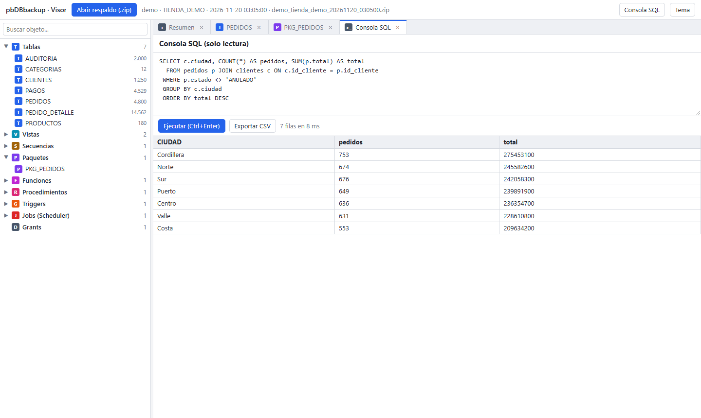 |
| **Paquetes**: spec y body con resaltado, "usa / usado por" | **Consola SQL** de solo lectura (SQLite en WebAssembly) |

<p align="center">
  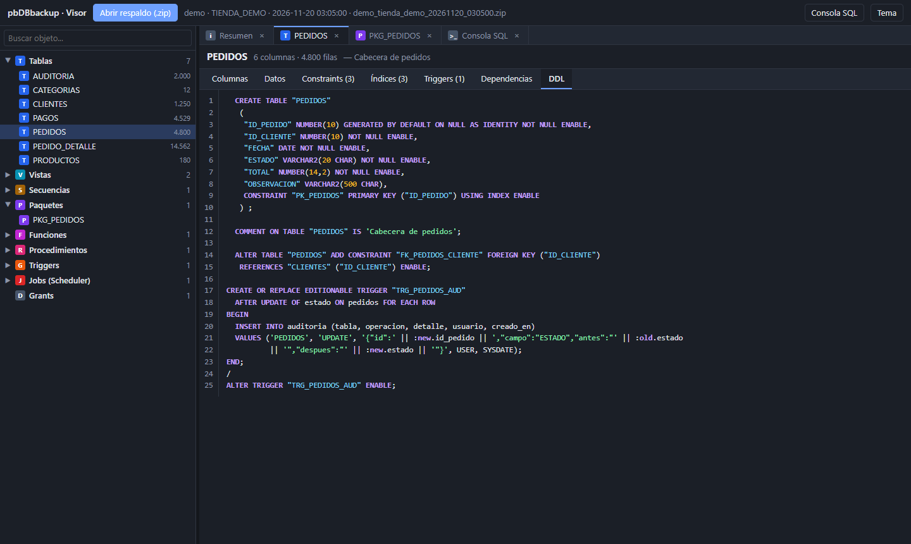<br>
  <em>Tema oscuro</em>
</p>

**Qué agrega `--visor` al zip** (los `.sql` siguen siendo lo que se restaura):

| Entrada | Contenido |
|---|---|
| `visor.html` | La interfaz, en un solo archivo |
| `visor/manifest.json` | Árbol de objetos: columnas, constraints, índices, triggers, código fuente, secuencias, vistas, jobs, grants y dependencias |
| `visor/datos/NNNN.jsonl.gz` | Las filas de cada tabla (una línea JSON por fila). Se leen solo al abrir la tabla |
| `visor/vendor/` | sql.js (SQLite en WebAssembly) para la consola SQL |

**Qué permite**

- **Árbol** de tablas, vistas, secuencias, paquetes, funciones, procedimientos, tipos, triggers, jobs, vistas materializadas, sinónimos, grants y DB links, con buscador.
- **Tablas** con pestañas de Columnas, Datos, Constraints, Índices, Triggers, Dependencias y DDL.
- **Datos** con columnas visibles a elección, filtros por columna (`texto`, `=x`, `>5`, `~regex`, `null`…), búsqueda global, orden, paginación, exportación a CSV y panel de detalle con navegación al padre y a las hijas por FK.
- **Código** con resaltado de sintaxis y relaciones "usa / usado por".
- **Jobs** con sus propiedades de `DBMS_SCHEDULER`, argumentos y DDL.
- **Consola SQL** de solo lectura sobre los datos del respaldo. Acepta `NVL`, `TO_CHAR`, `SYSDATE` y `FETCH FIRST n ROWS ONLY`, y carga en memoria solo las tablas que nombra la consulta.

**Límites:** está pensado para respaldos de hasta ~500 MB. Los datos van dos veces en el zip (en el `.sql` y en el `.jsonl.gz`), y los binarios se muestran solo como tamaño y primeros bytes en hex. El `manifest.json` lleva un número de formato y el visor avisa si el zip es más nuevo que él.

---

## Restaurar

Primero se restaura la estructura y después los datos, en un esquema vacío (o con un respaldo generado con `--con-delete`):

```bash
sql USUARIO@alias_tp @respaldo_tables.sql
sql USUARIO@alias_tp @respaldo_pkg.sql
sql USUARIO@alias_tp @respaldo_views.sql
sql USUARIO@alias_tp @respaldo_data.sql
sql USUARIO@alias_tp @respaldo_otros.sql
```

- Se recomienda SQLcl. Con SQL\*Plus, la sesión debe estar en UTF-8 (`NLS_LANG=AMERICAN_AMERICA.AL32UTF8`).
- `tables`, `pkg`, `views` y `data` se detienen ante el primer error (`WHENEVER SQLERROR EXIT`). `otros` sigue ante errores, por ejemplo un grant a un usuario que no existe.
- Los triggers de `tables` pueden quedar inválidos hasta que exista `pkg`. El bloque final de `pkg` y `views` recompila el esquema.
- Para restaurar en **otro esquema**, basta con descomentar la línea `ALTER SESSION SET CURRENT_SCHEMA` de la cabecera, porque las tablas van sin prefijo de owner.

---

## Copia en Cloudflare R2 y ejecución en varios nodos

Con `--subir`, el respaldo queda en la copia local como siempre y además se sube a un bucket **privado** de Cloudflare R2 (API S3). Después se verifica que el tamaño remoto coincida. Si la subida falla, la copia local no se toca y el proceso termina con código 1.

| Variable | Descripción |
|---|---|
| `R2_ACCOUNT_ID` (o `R2_ENDPOINT`) | Cuenta de R2 → `https://<id>.r2.cloudflarestorage.com` |
| `R2_ACCESS_KEY_ID` / `R2_SECRET_ACCESS_KEY` | Token de API con permiso *Object Read & Write* limitado al bucket |
| `R2_BUCKET` | Bucket de destino |
| `R2_PREFIJO` | Opcional: carpeta raíz dentro del bucket |
| `PBDB_NODO` | Opcional: nombre del nodo (por defecto, el hostname) |

Cada respaldo queda en `[prefijo/]<proyecto>/<AAAA-MM-DD>/<archivo>`, junto con un `_hecho.json` que registra el nodo, la hora y los tamaños. La retención en R2 se define con *Object lifecycle rules* del bucket.

### Ejecución programada en una o varias VM

Cada VM corre un **timer de systemd** (por ejemplo, cada 6 h con desfase aleatorio) que invoca la herramienta con `--una-por-dia`. Antes de conectarse a la base, cada nodo **reserva** el día en R2 con una escritura condicional (`If-None-Match: *`), así que solo uno gana aunque arranquen a la vez:

<p align="center">
  
</p>

| Copia local de hoy | `_hecho.json` en R2 | Qué hace el nodo |
|---|---|---|
| no | no | **Reserva** el día, extrae, sube, escribe `_hecho.json` y libera la reserva |
| no | sí, o reservado por otro nodo | Extrae igual y deja solo su copia local (`--si-en-r2 local`) o no hace nada (`omitir`) |
| sí | no | No toca la base: sube la copia local de hoy (reintenta una subida fallida) |
| sí | sí | Nada |

Si la extracción o la subida fallan, la reserva se borra para que otro nodo, o la siguiente pasada, lo reintente. Una reserva de más de 6 h se considera abandonada y se reemplaza con `If-Match`, sin carrera.

<p align="center">
  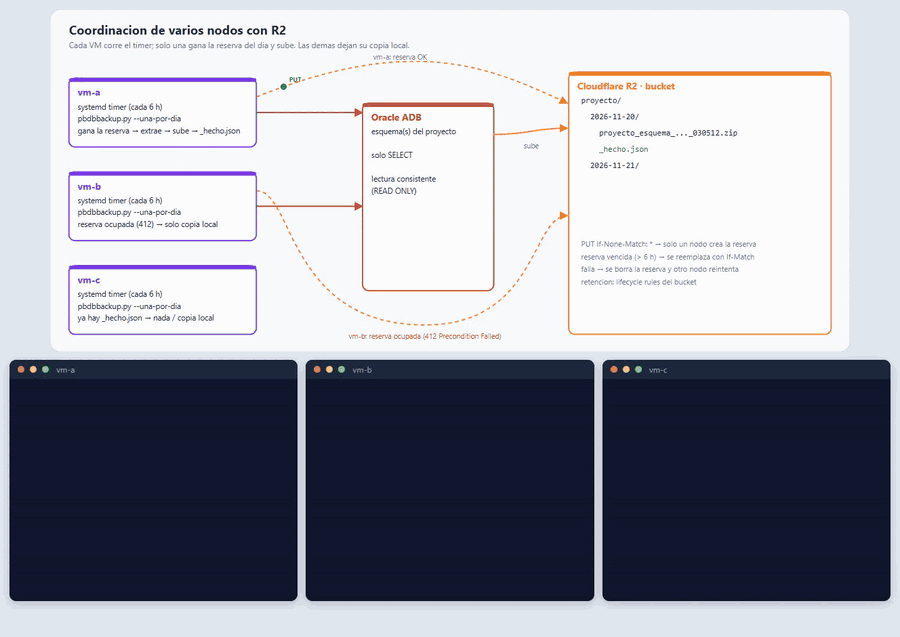
</p>

▶ [Ver en MP4](assets/video/sim-nodos.mp4)

---

<sub>Python 3.11+ · python-oracledb · Oracle Autonomous Database · Cloudflare R2 · sql.js · systemd</sub>
